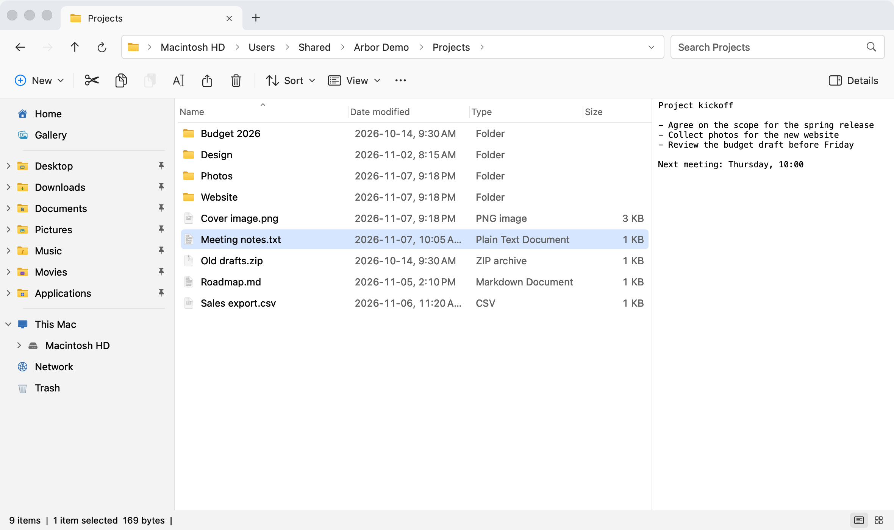
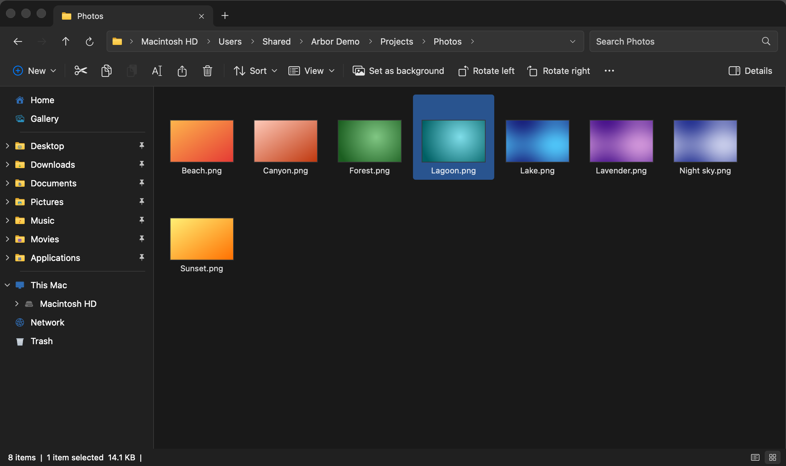

# Arbor

**A free, open-source file manager for macOS that works like Windows 11 File Explorer.** Tabs in the title bar, a
folder tree beside the file list, a breadcrumb address bar you can type into, a command bar, Details and icon views,
real cut and paste, and a status bar: the layout and habits Windows users already know, built natively for the Mac.

Arbor is released under the MIT license. It is an independent project.

> **Trademarks.** Arbor isn't affiliated with, endorsed by or sponsored by Microsoft. "Windows" and "File Explorer"
> are trademarks of Microsoft Corporation and are used here only to describe the behavior Arbor follows. Arbor uses
> its own artwork and the system font; no Microsoft icons, fonts or logos are included.

<p align="center">
  
</p>
<p align="center">
  
</p>

## Status

Version 0.2, an early but broad preview. Of the 258 requirements in the specification, 203 are implemented, 28
partly, 13 are macOS boundaries (no Mac counterpart, so Arbor offers the closest real equivalent instead of a fake
button) and 14 aren't done yet. Every one is listed in [docs/FEATURE-STATUS.md](docs/FEATURE-STATUS.md), and the
end-to-end task scenarios are recorded in [docs/ACCEPTANCE.md](docs/ACCEPTANCE.md).

No Windows reference machine was used while building it: parity is based on Microsoft's documentation and on recalled
behavior, so details such as exact spacing, colors or menu order may differ from a current Windows 11 build.

## Features

- **Tabs and windows.** New tabs open Home, like Explorer. Drag tabs to reorder, drag one out for a new window, or drop
  it on another window's tab row. Each tab keeps its own history, selection, search, sort and view.
- **Navigation.** Back, Forward, Up and Refresh; a breadcrumb address bar whose › menus list subfolders; type or paste
  a path, `~/Documents`, a `file://` URL, `smb://server/share` or a Windows UNC path (`\\server\share`). Typed text is
  never run as a command. A folder tree that expands without navigating.
- **Views.** Details (sortable, groupable columns with header filters and more metadata columns), List, Tiles, Content
  and four icon sizes with thumbnails; compact view, item check boxes, per-folder views and folder types (General
  items, Documents, Pictures, Music, Videos), set in a full Folder Options dialog.
- **Places.** Home (Quick access, Favorites, Recent), This Mac (drives with capacity bars), Gallery, Libraries, Network
  (discovered computers, shares, Map network drive), Trash (Original Location, Restore, Empty Trash), and iCloud Drive
  and other cloud folders with sync status.
- **Files.** Real cut and paste (originals are removed only after each copy succeeds), Replace or Skip and compare
  dialogs, folder merge, byte progress with pause and resume, Operation history, recovery after a crash, New ▸
  templates, shortcuts (Mac aliases), Send to, batch rename, rotate images, Properties with Security, Details and
  Previous Versions.
- **Search.** Searches subfolders with Spotlight and a direct scan, understands much of Explorer's query syntax
  (`kind:`, `size:>1MB`, `date:last week`, `AND`/`OR`/`NOT`), ranks name matches first and says when results may be
  incomplete and why.
- **Archives.** Browse and extract ZIP, 7z, TAR (and gzip, bzip2, xz) archives; create ZIP, 7z and TAR; mount ISO
  images. Unsafe archive members are never extracted.
- **Safety.** Delete moves to the Trash; anything permanent asks first. Undo refuses rather than overwrite something
  changed since. Replacing a file moves the old one to the Trash.
- **Accessibility.** Every action works from the keyboard (F6 between regions, ⇧F10 for context menus); every control
  has a VoiceOver name; text size, increased contrast and right-to-left layouts are supported.

## Keyboard (Windows → Arbor)

| Windows | Arbor | Does |
|---|---|---|
| Enter | Return | Open |
| Ctrl+Enter | ⌘Return | Open in a new tab |
| F2 | F2 | Rename (Tab moves to the next item) |
| Alt+← / Backspace | ⌘[ / ⌥← / Delete | Back |
| Alt+→ | ⌘] / ⌥→ | Forward |
| Alt+↑ | ⌘↑ / ⌥↑ | Up |
| F5 / Ctrl+R | F5 / ⌘R | Refresh |
| Alt+D / Ctrl+L | ⌘L | Type a path |
| Ctrl+F / Ctrl+E | ⌘F | Search |
| Ctrl+T / Ctrl+W | ⌘T / ⌘W | New tab / close tab |
| Ctrl+N | ⌘N | New window |
| Ctrl+Tab / Ctrl+Shift+Tab | ⌃Tab / ⌃⇧Tab | Next / previous tab |
| Ctrl+1…9 | ⌘1…9 | Go to tab |
| Ctrl+Shift+N | ⇧⌘N | New folder |
| Ctrl+X / C / V | ⌘X / C / V | Cut / copy / paste |
| Ctrl+Z / Ctrl+Y | ⌘Z / ⇧⌘Z | Undo / redo |
| Ctrl+A | ⌘A | Select all |
| Delete | fn+Delete or ⌘⌫ | Move to Trash |
| Shift+Delete | fn+⇧Delete or ⌥⌘⌫ | Delete permanently (asks first) |
| Alt+Enter | ⌥Return or ⌘I | Properties |
| Alt+P | ⌥⌘P | Preview pane |
| Alt+Shift+P | ⇧⌥⌘P | Details pane |
| Ctrl+Shift+1…8 | ⇧⌘1…8 | View modes |
| Shift+F10 / Menu key | ⇧F10 | Context menu |
| F6 / Tab | F6 / Tab | Move between regions |
| Ctrl+Shift+C (copy as path) | ⌥⌘C | Copy as path |
| — | ⇧⌘. | Show hidden items |
| — | Space | Quick Look |

On a Mac keyboard, F-keys may need **fn** unless "Use F1, F2, etc. keys as standard function keys" is on in System
Settings → Keyboard.

## System requirements

macOS 14 Sonoma or later, on Apple silicon or Intel Macs (one universal app).

## Install

### Download

When a release is available, download `Arbor-<version>.dmg` from this repository's [Releases](../../releases) page,
open it and drag **Arbor** onto **Applications**. Each release lists a SHA-256 checksum; check it with
`shasum -a 256 Arbor-<version>.dmg`.

**Unsigned builds and Gatekeeper.** Until releases are signed with an Apple Developer ID and notarized (the release
notes say which you have), macOS blocks the first launch because it can't verify the developer. To open Arbor anyway,
once:

- Try to open Arbor, then go to **System Settings → Privacy & Security**, scroll to Security, click **Open Anyway** next
  to the message about Arbor and confirm.
- On macOS 14 you can also Control-click Arbor in Applications, choose **Open**, then **Open** again.

Only do this for a download you trust (this repository's Releases page). The first time you open Desktop, Documents or
Downloads, macOS asks whether Arbor may access them; Arbor only asks for what you open.

### Build from source

Needs only Apple's free Command Line Tools (Xcode is optional):

```bash
xcode-select --install          # once, if the tools aren't installed
git clone <this repository's URL> arbor && cd arbor
scripts/build-app.sh            # builds build/Arbor.app for this Mac
open build/Arbor.app
```

Drag `build/Arbor.app` into `/Applications` to keep it. `scripts/build-app.sh release --universal` builds one app for
both Apple silicon and Intel, and `scripts/make-dmg.sh` makes the disk image ([docs/RELEASING.md](docs/RELEASING.md)).
From Terminal, `/Applications/Arbor.app/Contents/MacOS/Arbor ~/Projects` opens a given folder.

## Privacy

Arbor has no telemetry, no analytics and no crash reporter, and makes no network connections of its own. It connects
only to servers you open (network shares) and reads cloud status that macOS already provides locally. Recent files and
frequent folders stay on your Mac and can be turned off or cleared in Folder Options.

## Documentation

| Document | What's in it |
|---|---|
| [docs/FEATURE-STATUS.md](docs/FEATURE-STATUS.md) | Status of every requirement (FE-001…FE-258) |
| [docs/ACCEPTANCE.md](docs/ACCEPTANCE.md) | Results of the task scenarios T01–T30 |
| [docs/SPEC.md](docs/SPEC.md) | Product vision and behavioral specification |
| [docs/DECISIONS.md](docs/DECISIONS.md) | Decision log, with an index of each area's decisions |
| [docs/ARCHITECTURE.md](docs/ARCHITECTURE.md) | Code layout, registries and hooks for adding features |
| [docs/features/](docs/features/) | One document per feature area: status, decisions, known gaps |
| [docs/PERFORMANCE.md](docs/PERFORMANCE.md) | Memory and responsiveness budgets and measurements |
| [docs/research/windows11-reference.md](docs/research/windows11-reference.md) | The Explorer behavior Arbor follows, with sources |
| [TESTING.md](TESTING.md) | Unit tests and headless scripted checks |
| [docs/RELEASING.md](docs/RELEASING.md) | Building, signing and publishing releases |
| [CHANGELOG.md](CHANGELOG.md) | What changed in each version |

## Contributing

Contributions are welcome. Read [CONTRIBUTING.md](CONTRIBUTING.md) first: it covers the safety rules for file
operations, how to link changes to requirement IDs, and the checks every change must pass (`scripts/test.sh`, a
warning-free `scripts/build-app.sh debug`, and a headless check for UI behavior). Report security problems privately as
described in [SECURITY.md](SECURITY.md).

## License

MIT. See [LICENSE](LICENSE).
